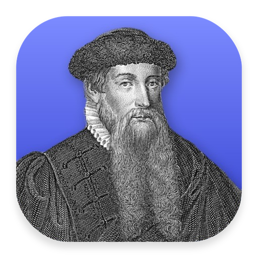

<div align="center">
  
  <h1>Pliego</h1>
  <p><strong>An editorial layout application for the Nodalia suite, built on the DesignCraft engine.</strong></p>

  <p>
    
    
    
    
  </p>

  <p>
    <a href="#overview">Overview</a> ·
    <a href="#what-you-get-today">Today</a> ·
    <a href="#build-and-run">Build</a> ·
    <a href="#project-status">Status</a> ·
    <a href="#keeping-up-with-upstream">Upstream</a> ·
    <a href="#the-nodalia-suite">Suite</a> ·
    <a href="#license">License</a>
  </p>
</div>

---

## Overview

**Pliego** is the editorial layout application of [Nodalia](https://getnodalia.com). It is built on the engine of
[DesignCraft](https://github.com/storytold/designcraft), which lives in this repository and is kept up to
date with upstream.

> [!IMPORTANT]
> **Pliego is at an early stage.** What runs today is the upstream application under the Pliego name.
> Nodalia's own interface is not wired in yet and there are no published builds.

## What you get today

- The DesignCraft engine.
- A desktop binary called `pliego`.
- The engine's own feature description, kept as [`docs/upstream-readme.md`](docs/upstream-readme.md).

## Build and run

You need a recent stable Rust toolchain.

```bash
git clone https://github.com/danielmigueltejedor/pliego.git
cd pliego
cargo run --release -p designcraft
```

The desktop binary is called `pliego`.

## Project status

| Area | State |
|---|---|
| Engine | Imported from `storytold/designcraft` and tracked in [`docs/upstream.md`](docs/upstream.md) |
| Product name | Done: the desktop binary is called `pliego` |
| App icon | Done: portrait of Johannes Gutenberg |
| Nodalia interface | Not started |
| Shared interface resources | Planned: the Nodalia apps will share interface components and styles |
| Installable packages | None published |

## Keeping up with upstream

[`docs/upstream.md`](docs/upstream.md) records which upstream commit is integrated. Updates are
merges of upstream's `main`, so Pliego's own changes are kept and conflicts are resolved in the open.

## App icon

Nodalia app icons are black-and-white portraits of historical figures over the app colour.
Pliego's is Johannes Gutenberg, who introduced movable-type printing. Provenance and licence are in [`assets/app-icon/`](assets/app-icon/).

## The Nodalia suite

Pliego is one of the applications of [Nodalia](https://getnodalia.com), an independent software
project developed in public by [Daniel Miguel Tejedor](https://danielmigueltejedor.com).

## License

`MIT OR Apache-2.0`, as upstream. The licence files and `NOTICE` of DesignCraft are kept.
See [`LICENSE-MIT`](LICENSE-MIT) and [`LICENSE-APACHE`](LICENSE-APACHE).

## Credits

Pliego would not exist without [DesignCraft](https://github.com/storytold/designcraft) and its contributors.
